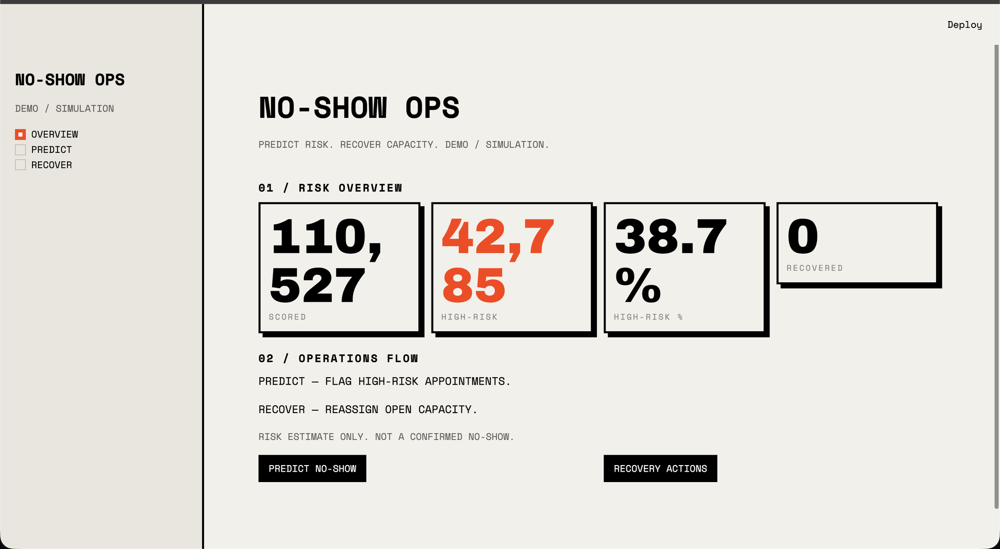
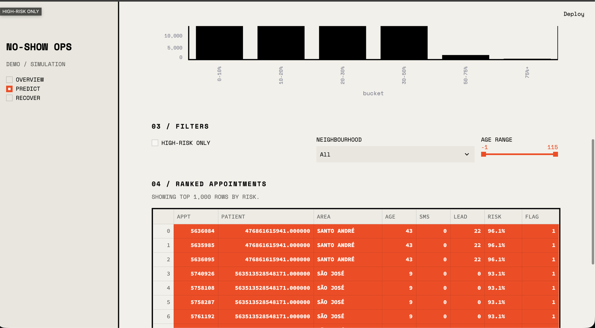
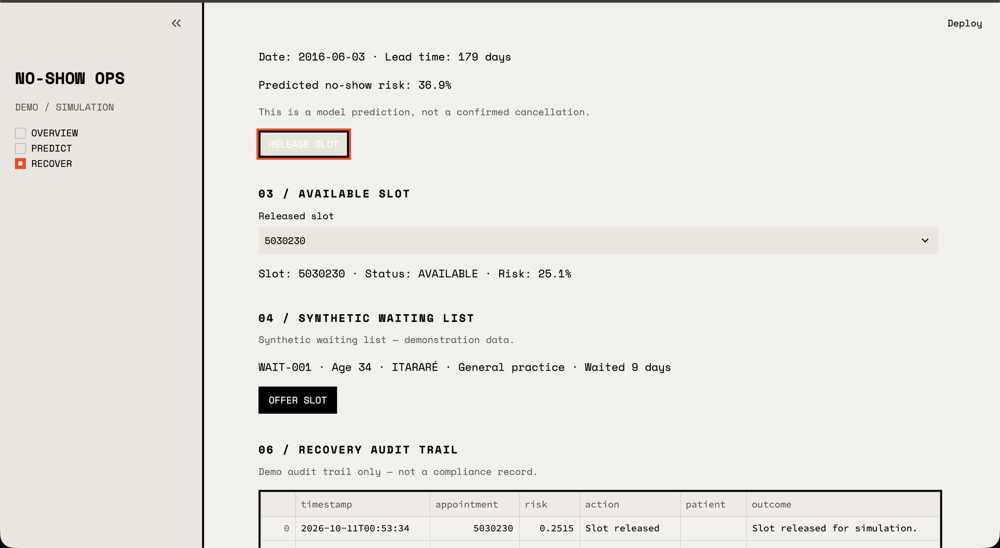

# Hospital Appointment No-Show Prediction

Predicts whether a patient will miss a hospital appointment and suggests recovery actions based on the risk score.

> **Demo disclaimer:** This is a hackathon demo, not a medical tool. Do not use it for clinical decisions.

## Why this matters

When patients miss appointments, doctors sit idle and clinic time goes to waste. Other patients who need care wait longer for a slot. A missed visit can also delay treatment for the patient who did not show up. Predicting no-shows helps clinics plan better.

## What the project does

1. **Prediction.** Estimates the chance that each appointment ends in a no-show.
2. **Recovery suggestions.** Flags high-risk appointments so staff can send a reminder, call, or offer to reschedule.
3. **Dashboard.** A Streamlit app with Overview, Predict, and Recover pages to view risk and simulate recovery.

## The data

- Main file: `appointments_v3.csv`
- Rows: 110,527 in the file (110,514 after removing invalid rows, such as appointments dated before they were booked)
- Base no-show rate: about 20.19% (roughly 1 in 5 appointments is missed)
- Source: Kaggle Medical Appointment No-Shows dataset (Vitoria, Brazil, 2016)
- Note: other CSVs in the folder (`cleaned_appointments.csv`, `appointments_v2.csv`, `appointments_feature_engineered_v2.csv`) are older versions from earlier steps.

## How it works

1. **Clean the data.** Impossible rows are removed, such as appointments dated before they were booked. This leaves 110,514 valid rows.
2. **Engineer features.** New columns are built from raw ones, for example how many days ahead the appointment was booked. Patient history features count each patient's past visits and past no-shows (`prior_appointments`, `prior_no_shows`, `is_defaulter`).
3. **Train the model.** A gradient boosting classifier (a model that combines many small decision trees) learns patterns linked to no-shows.
4. **Calibrate probabilities.** Calibration (adjusting scores so they match reality) makes each score honest. A score of 0.30 should mean about 30% of similar patients miss their appointment. This uses a method called isotonic calibration.
5. **Evaluate.** The main metric is PR-AUC, 0.4104. PR-AUC (precision-recall area under the curve) measures how well the model ranks the rare no-show cases. Accuracy is misleading here: always predicting "will attend" scores about 80% but catches zero no-shows.

## Project structure

```
app/
  main.py        # dashboard entry point (Overview, Predict, Recover)
  predict.py     # Predict screen
  recover.py     # Recover simulation screen
  scoring.py     # loads the model and scores new appointments
  shared.py      # shared cached data/model loading
  theme.py       # dashboard styling
models/
  best_calibrated_v3_candidate.joblib  # deployed model
  best_calibrated.joblib               # earlier experiment artifact
  logreg_baseline.joblib               # earlier experiment artifact
  v3_ablated_no_history.joblib         # earlier experiment artifact
appointments_v3.csv      # main dataset used by the app
cleaned_appointments.csv # earlier cleaning step (older version)
appointments_v2.csv      # earlier feature set (older version)
appointments_feature_engineered_v2.csv  # earlier feature set (older version)
reports/       # metrics, comparisons, and figures from experiments
docs/screenshots/  # demo screenshots
requirements.txt  # Python dependencies
README.md         # this file
```

## How to run it

1. Clone the repo:
```
git clone https://github.com/[USERNAME]/healthcare.git
cd healthcare
```
2. Create a virtual environment:
```
python3 -m venv venv
source venv/bin/activate
```
3. Install dependencies:
```
pip install -r requirements.txt
```
4. Run the app (Windows: `venv\Scripts\activate` in step 2):
```
streamlit run app/main.py
```

## Screenshots

Screenshots live in `docs/screenshots/`.





## Limitations

- The data comes from one demo dataset and may not match real patients at another clinic.
- The model uses a limited set of features and cannot see real reasons for missing visits, such as transport or illness.
- Predictions show patterns across many patients, not certainties about any one person.

## What I learned

- With imbalanced data (few no-shows among many visits), accuracy lies, so ranking metrics like PR-AUC matter more.
- Raw model scores can mislead; calibration turns them into honest probabilities.
- A model only becomes useful when wrapped in an app people can click, filter, and export from.

## Tech stack

Python, pandas, scikit-learn, Streamlit, joblib.

## Author

Purusharth, B.Tech ECE, Punjab Engineering College.
